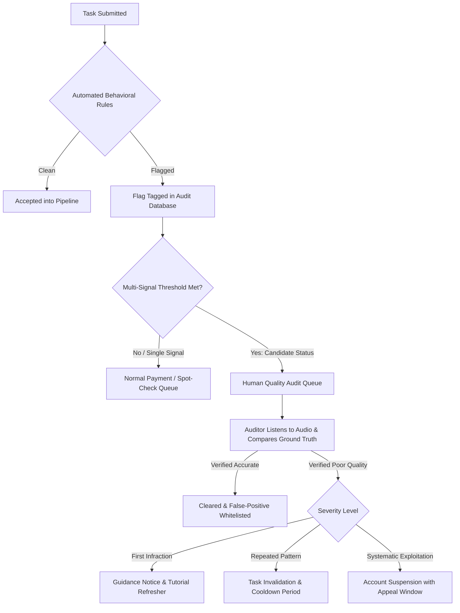

# Transcription Quality Monitoring & Governance Framework

> **Important Policy Disclaimer:**
> The thresholds, warning flags, and enforcement rules detailed in this document represent a **proposed governance and review framework** developed through empirical data analysis. They are designed to triage submissions for human audit and **do not constitute definitive proof of misconduct or intentional fraud**. No punitive measures (such as account suspension, payment withholding, or removal) should ever be taken automatically without verified ground-truth human inspection.

---

## 1. Executive Summary & Objective

Crowdsourced transcription pipelines rely on transcribers to listen to speech audio, verify automated speech recognition (ASR) outputs (e.g., Whisper), and correct grammatical or phonetic inaccuracies. Because contributors are compensated per unit of work, platforms encounter varying behavioral patterns ranging from diligent editing to rapid pass-through submissions and empty submissions.

The objective of this framework is to establish an objective, reproducible, and balanced monitoring system that:
1. Identifies anomalous task-level submission patterns using behavioral heuristics.
2. Isolates repeat transcribers exhibiting multi-signal anomalies.
3. Implements a human-in-the-loop review workflow to safeguard quality while minimizing false accusations.

---

## 2. Core Warning Signals & Empirical Definitions

Through statistical analysis of **51,783 task records**, four primary warning signals were identified:

| Signal Identifier | Operational Definition | Filter Constraints | Verified Frequency (Tasks) | Dataset Share (%) |
|:---|:---|:---|:---:|:---:|
| **`flag_blank_submission`** | Transcriber submitted an empty string `""` or literal `[blank]` when Whisper detected valid speech text. | `duration > 1.0s` AND `whisper_text != ""` | **1,019** | **1.97%** |
| **`flag_extreme_low_ter`** | Transcriber completed the task at a Task-to-Audio Time Ratio (TER) in the bottom 1st percentile ($TER < 0.1788$). | `duration > 1.0s` AND `ter` is finite | **517** | **1.00%** |
| **`flag_ter_below_1`** | Transcriber spent less total time on the task than the real-time audio playback length ($TER < 1.0$). | `duration > 1.0s` AND `ter` is finite | **5,939** | **11.47%** |
| **`flag_extreme_cps`** | Character throughput ($CPS = \frac{\text{chars}}{\text{task time}}$) falls in the top 2nd percentile ($CPS > 59.8576$ chars/sec $\approx 700$ WPM). | `duration > 5.0s` AND `user_task_cps` is finite | **457** | **0.88%** |

### Union of Warning Signals
- **Total Unique Tasks Flagged by at least one signal:** **6,832 tasks (13.19%)**
- **Clean Baseline Submissions:** **44,951 tasks (86.81%)**

---

## 3. Signal Co-Occurrence & The "Zero-Review Pass-Through" Cohort

Examining the cross-signal overlap matrix reveals that extreme speed anomalies cluster together:

```text
                       flag_blank_submission  flag_extreme_low_ter  flag_ter_below_1  flag_extreme_cps
flag_blank_submission                   1019                     0               126                 0
flag_extreme_low_ter                       0                   517               517               346
flag_ter_below_1                         126                   517              5939               457
flag_extreme_cps                           0                   346               457               457
```

### Key Observation: Zero-Review Pass-Through
There is an exact overlap of **346 tasks** meeting all three of the following conditions:
1. `flag_extreme_low_ter` ($TER < 0.1788$)
2. `flag_extreme_cps` ($CPS > 59.86$)
3. Exact identity between user submission and pre-populated Whisper text (`user_text == whisper_text`), with platform edit status recorded as `"No"`.

**Empirical Properties of this Cohort:**
- Mean task time: **1.81 seconds** (on audio clips averaging 10–15 seconds).
- 100% of these tasks were submitted without any character edits.
- *Interpretation:* The user simply clicked "Submit" almost immediately upon loading the task, effectively bypassing the transcription and proofreading process.

---

## 4. Transcriber Population & Repeat User Risk Profile

Of the **48,875 unique user IDs** present in the 51,783-task dataset:
- **Single-task users:** 48,865 accounts (99.98% of all users, contributing 48,865 tasks).
- **Repeat transcribers (> 1 task):** Exactly 10 accounts (0.02% of users), contributing 2,918 tasks.

### Audit of All 10 Repeat Transcribers

| Transcriber ID | Total Tasks | Blank Submissions | Extreme Low TER Tasks | TER < 1.0 Tasks | Extreme CPS Tasks | Total Flagged Tasks | Overall Warning Rate (%) |
|:---:|:---:|:---:|:---:|:---:|:---:|:---:|:---:|
| `580062` | 609 | 7 | 0 | 164 | 0 | 171 | **28.08%** |
| `393886` | 509 | 4 | 0 | 123 | 0 | 127 | **24.95%** |
| `410566` | 349 | 0 | 0 | 105 | 0 | 105 | **30.09%** |
| `681509` | 358 | 1 | 0 | 99 | 0 | 100 | **27.93%** |
| `222099` | 333 | 0 | 0 | 89 | 0 | 89 | **26.73%** |
| `311760` | 184 | 0 | 0 | 57 | 0 | 57 | **30.98%** |
| `632098` | 165 | 2 | 0 | 54 | 0 | 56 | **33.94%** |
| `467270` | 176 | 0 | 0 | 50 | 0 | 50 | **28.41%** |
| `326611` | 149 | 2 | 0 | 35 | 0 | 37 | **24.83%** |
| `688393` | 86 | 0 | 0 | 27 | 0 | 27 | **31.40%** |

*Crucial Statistical Finding:* None of the 10 repeat transcribers exhibited the extreme burst anomalies (`extreme_low_ter` or `extreme_cps`). Their warning rates were driven predominantly by moderate rushing ($TER < 1.0$, occurring in 24%–34% of their tasks) and occasional blank submissions. The 346 instant pass-through tasks originated entirely from single-task accounts.

---

## 5. Proposed Review & Governance Framework

To balance quality assurance with fairness to transcribers, the following multi-tiered policy is proposed:

### Policy Rule: Candidacy for Targeted Quality Audit
An account is flagged as a **Candidate for Quality Audit** if and only if both conditions are met:
1. **Minimum Exposure:** Account has completed at least **5 tasks** ($N \ge 5$).
2. **Multi-Signal Concurrence:** The account breaches at least **two** of the following four behavioral thresholds:
   - Blank submission rate $> 2.0\%$
   - Extreme low TER rate $> 0.0\%$
   - Extreme CPS rate $> 0.0\%$
   - Moderate rushing rate ($TER < 1.0$) $> 30.0\%$

### Audit Candidates Identified in Dataset:
Based on this objective rule, exactly **3 transcribers** are prioritized for review:
1. **User `580062`:** 609 tasks, blank rate = 2.23% (7 blanks), TER < 1 rate = 42.38% (164 tasks).
2. **User `632098`:** 165 tasks, blank rate = 2.22% (2 blanks), TER < 1 rate = 51.92% (54 tasks).
3. **User `326611`:** 149 tasks, blank rate = 3.28% (2 blanks), TER < 1 rate = 40.70% (35 tasks).

---

## 6. False-Positive Risks & Safeguards

Automated signals cannot replace context. The review board must consider the following known edge cases:

1. **Short Audio Clips ($\le 1.0$s):** A 0.5-second clip of background noise or a monosyllabic filler ("हाँ", "ok") can legitimately be reviewed and submitted in under 1 second. Therefore, all timing and blank signals must strictly apply only to clips $> 1.0$s.
2. **High-Accuracy ASR Matches:** When Whisper produces a 100% flawless transcript of clear speech, an experienced transcriber may listen at $1.5\times$ speed and submit without edits. This results in $TER \approx 0.67$ without compromising accuracy. Rushing signals should never be evaluated in isolation.
3. **Legitimate Silence or Noise:** Audio recordings containing only static, breath sounds, or background noise legitimately warrant a `[blank]` or empty transcription. Reviewers must cross-examine the audio recording before deeming a `[blank]` erroneous.
4. **Network & Client Latency:** Unstable client connections can occasionally cause time-tracking scripts to log inaccurate task durations.

---

## 7. Staged Enforcement Workflow

When an account or submission is flagged, platform administrators must follow a **progressive, transparent 4-stage enforcement protocol**:



### Stage 1: Passive Flagging (No Disruption)
- Behavioral signals are logged asynchronously without interrupting task flow or delaying standard payouts.
- Avoids punishing transcribers for isolated anomalies.

### Stage 2: Audit Queue Routing
- Tasks from flagged accounts are routed to a senior QA queue before downstream model ingestion.
- The platform retains the task output while verifying quality.

### Stage 3: Human Verification
- An auditor listens to a random sample of at least 5 flagged tasks and 5 non-flagged tasks from the transcriber.
- Ground truth Word Error Rate (WER) or Character Error Rate (CER) is calculated.

### Stage 4: Proportional Remediation
- **Level 1 (Minor Quality Deviations):** Educational feedback provided in the transcriber portal explaining guidelines on silent clips and editing.
- **Level 2 (Persistent Non-Review):** Work is requeued; account temporarily limited to small batch sizes.
- **Level 3 (Confirmed Willful Bypass):** Account offboarded after senior reviewer sign-off, with a documented 14-day appeals process.
