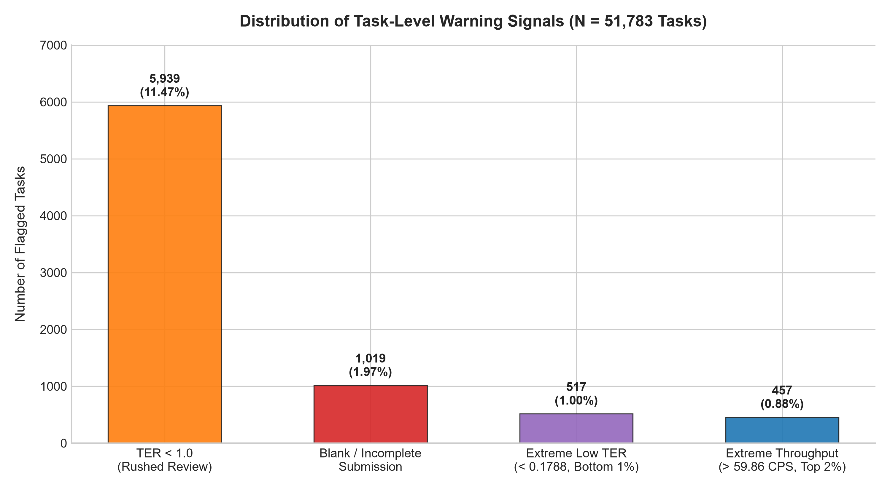
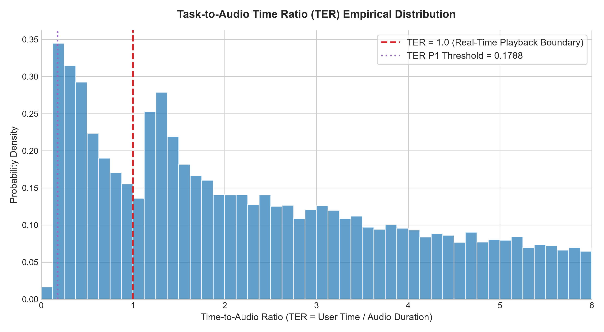
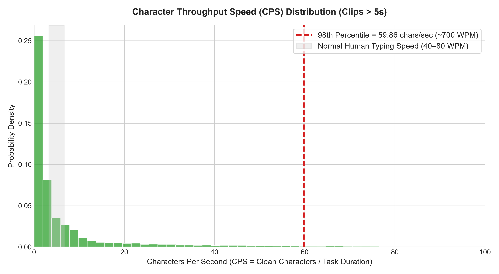
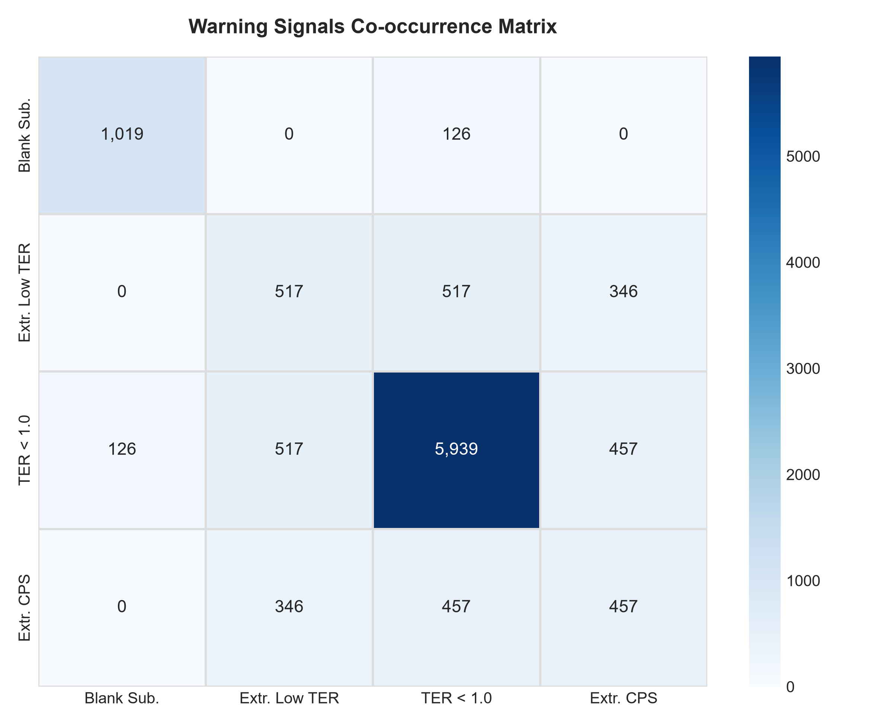
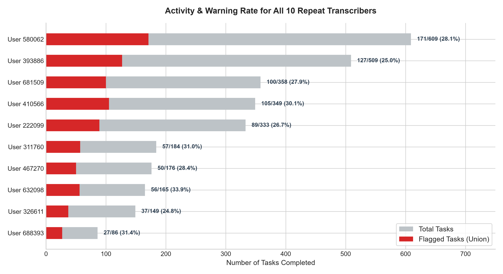

# Josh Talks Transcription Quality Analysis — Comprehensive Audit Report

## Executive Summary

Crowdsourced transcription quality is critical for downstream automated speech recognition (ASR) fine-tuning and natural language processing pipelines. This report presents an empirical analysis of **51,783 transcription tasks** submitted by **48,875 unique contributors** on the Josh Talks data collection platform.

By modeling the relationship between user task completion time, audio recording duration, transcript character length, and automated speech recognition (Whisper) baseline text, we designed four orthogonal warning signals to detect potential quality risks.

---

## Key Metrics at a Glance

| Metric | Verified Value | Context / Benchmark |
|:---|:---:|:---|
| **Total Task Submissions** | **51,783** | Complete evaluation dataset |
| **Unique Transcribers** | **48,875** | Platform contributor base |
| **Single-Task Contributors** | **48,865 (99.98%)** | Severe contributor fragmentation |
| **Repeat Transcribers ($N > 1$)** | **10 (0.02%)** | Contributed 2,918 total tasks |
| **Empirical TER P1 Threshold** | **0.1788** | 1st percentile of Task-to-Audio Ratio |
| **Empirical CPS P98 Threshold** | **59.8576** | 98th percentile throughput (~700 WPM) |
| **Total Tasks Flagged (Union)** | **6,832 (13.19%)** | Unique tasks flagged by $\ge 1$ warning rule |
| **Clean Baseline Submissions** | **44,951 (86.81%)** | Tasks with no warning signals |
| **Zero-Review Pass-Through Cohort** | **346 tasks** | Extreme TER + Extreme CPS + Unedited Whisper |

---

## 1. Task-Level Warning Signals

Four warning signals were formulated to detect distinct modes of potential review bypass or transcription failure:

1. **`flag_ter_below_1` (5,939 tasks, 11.47%):** Task-to-Audio Time Ratio (TER) below 1.0. The transcriber spent less time on the screen than the real-time audio playback length. While listening at $1.25\times$ or $1.5\times$ speed can explain moderate values, this signal serves as an indicator of rushed reviews.
2. **`flag_blank_submission` (1,019 tasks, 1.97%):** The user submitted an empty string `""` or literal `[blank]` token on audio clips longer than 1.0 second where Whisper successfully transcribed speech.
3. **`flag_extreme_low_ter` (517 tasks, 1.00%):** Transcribers completing tasks at $TER < 0.1788$ (the bottom 1st percentile of the entire population).
4. **`flag_extreme_cps` (457 tasks, 0.88%):** Non-whitespace character production speed exceeding 59.86 characters per second (~700 words per minute), representing the top 2% of throughput for clips $> 5$ seconds.

---

## 2. Empirical Distribution Analysis

### Task-to-Audio Ratio (TER) Distribution

The vast majority of human transcribers spend $1.5\times$ to $5\times$ the audio duration to listen, pause, type, and verify text. However, a noticeable cluster of submissions falls strictly to the left of the $TER = 1.0$ boundary, with a sharp spike below $TER = 0.20$.

### Character Throughput Speed (CPS) Distribution

Normal human typing speed ranges between 40 and 80 words per minute (approximately 3.3 to 6.7 characters per second). Sustained speeds exceeding 25 CPS are physically impossible for manual keyboard entry, indicating immediate submission of pre-populated text without typing or significant proofreading.

---

## 3. Signal Co-Occurrence & Pass-Through Behavior

A cross-tabulation of warning flags reveals strong mutual reinforcement:
- **346 tasks** simultaneously exhibited extreme low TER ($< 0.1788$), extreme CPS ($> 59.86$), and exact identity between user text and Whisper text.
- **100% of these 346 tasks** were recorded with platform edit status `"No"`.
- The mean task duration for this cohort was **1.81 seconds**, confirming zero-review pass-through submissions.

---

## 4. Longitudinal Audit of Repeat Transcribers

A key structural characteristic of the dataset is extreme contributor skew: **99.98% of users only ever completed a single task**, while **10 users completed between 86 and 609 tasks each** (2,918 tasks total).

### Findings on Repeat Users:
- All 10 repeat transcribers have warning rates between 24.8% and 33.9%.
- However, their flags are almost exclusively driven by moderate rushing ($TER < 1.0$).
- **Zero repeat transcribers** exhibited extreme burst throughput or the zero-review pass-through behavior.
- Under the proposed multi-signal governance rule ($\ge 5$ tasks and $\ge 2$ distinct warning signals), **3 transcribers** (User IDs `580062`, `632098`, and `326611`) are identified as candidates for human quality audit due to elevated blank submission rates ($> 2.2\%$) paired with elevated $TER < 1.0$ rates ($> 40\%$).

---

## 5. Methodological Limitations & Future Scope

1. **Absence of Ground Truth WER/CER:** The dataset does not provide human expert consensus ground truth transcripts. Therefore, warning signals highlight *statistical anomalies*, not confirmed errors.
2. **Single-Task User Domination:** Because 48,865 users completed only one task, individual-level longitudinal profiling is constrained for 94.4% of the dataset. Platform mechanics (e.g., onboarding drop-off) should be investigated.
3. **Audio Quality Nuances:** Silent or noisy audio recordings may legitimately warrant `[blank]` submissions. Integrating acoustic voice activity detection (VAD) would significantly reduce false positives.
